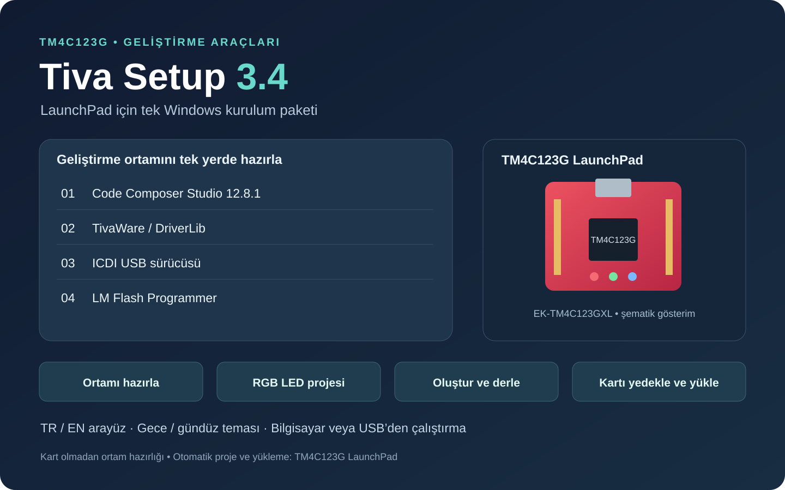

# Tiva Setup 3.4

Texas Instruments **Tiva C TM4C123G LaunchPad (EK-TM4C123GXL)** kartını kullanmaya başlamak için geliştirilmiş bir Windows kurulum uygulamasıdır. Gerekli yazılımları ve ayarları tek yerde toplayarak kartı programlamaya hazır hâle getirir.



*Görsel, uygulama sahibinin verdiği özelliklerden hazırlanan tanıtım özetidir; uygulamadan alınmış ekran görüntüsü değildir.*

## İndir

**[TivaSetup-3.4.exe — indir](https://github.com/furkanyrtsvr/TM4C123G/releases/download/tivasetup-v3.4.0/TivaSetup-3.4.exe)** · [Sürüm sayfası](https://github.com/furkanyrtsvr/TM4C123G/releases/tag/tivasetup-v3.4.0)

Dosya boyutu: **1.549.503.524 bayt**, yaklaşık **1,55 GB / 1,44 GiB**. Büyük kurulum dosyası GitHub Release varlığı olarak saklanır; bu klasörde rehberi, tanıtım görseli ve doğrulama dosyaları bulunur. GitHub’ın **Code → Download ZIP** veya **Source code** arşivi EXE’yi içermez.

## Amaç ve özellikler

- **Tek paketten ortam hazırlama:** Code Composer Studio **12.8.1**, TivaWare, ICDI USB sürücüsü ve LM Flash Programmer kurulum dosyaları.
- **Kurulu bileşen kontrolü:** Bilgisayarda hazır olan bileşenleri kontrol eder ve atlar.
- **Hazır örnek proje:** TM4C kartı için DriverLib ayarları yapılmış RGB LED projesi oluşturabilir ve derleyebilir.
- **Karta yükleme:** Bağlı TM4C123G LaunchPad’e örnek programı yükleyebilir; yüklemeden önce karttaki mevcut programın yedeğini alır.
- **Taşınabilir dağıtım:** Tek EXE, bilgisayardan veya USB bellekten çalıştırılabilir.
- **Kart olmadan hazırlık:** Geliştirme ortamı kart bağlı olmadan hazırlanabilir; kart daha sonra bağlandığında program yüklenebilir.
- **Arayüz seçenekleri:** Türkçe/İngilizce, gece/gündüz teması ve CCS aygıt ailesi seçimi.

Diğer aygıt aileleri için CCS kurulumu seçilebilir. Otomatik örnek proje, derleme ve karta yükleme akışı **TM4C123G LaunchPad** için tasarlanmıştır.

## Başlamadan önce

- Windows bilgisayar kullanın. Desteklenen Windows sürümü, işlemci mimarisi ve kesin disk gereksinimi için ayrı bir uyumluluk listesi henüz sağlanmadı.
- EXE ve içerdiği araçların kurulumu için yeterli boş alan ayırın. Araç ve USB sürücüsü kurulumları Windows yönetici izni isteyebilir.
- Karta program yükleyecekseniz EK-TM4C123GXL kartını veri aktarabilen bir USB kablosuyla bilgisayara bağlayın.

## Kurulum ve kullanım

1. Yukarıdaki **EXE indirme** bağlantısını kullanın. İsterseniz dosyayı USB belleğe kopyalayın.
2. `TivaSetup-3.4.exe` dosyasını Windows’ta çalıştırın.
3. Dil ve tema tercihinizi yapın. TM4C123G LaunchPad için ilgili CCS aygıt ailesini seçin.
4. Uygulamanın mevcut bileşenleri kontrol etmesini sağlayın ve eksik bileşenlerin kurulum adımlarını tamamlayın. Windows izin istemlerini kurulum sırasında değerlendirin.
5. Kart bağlı değilse ortam hazırlığını tamamlayıp kartı daha sonra bağlayın.
6. Kartı programlamaya hazır olduğunuzda DriverLib ayarlı RGB LED örneğini oluşturma, derleme ve yükleme akışını kullanın.
7. Uygulamanın yükleme öncesi aldığı mevcut program yedeğini saklayın. Yükleme, kartın mevcut programını örnek programla değiştirir.

Arayüz düğmelerinin birebir adları ve yedeklerin kaydedildiği kesin yol bu aktarımda doğrulanmadı; uygulamanın gösterdiği konumu takip edin.

## Dosya bütünlüğü

[SHA-256 dosyası](TivaSetup-3.4.exe.sha256) ve [sürüm bilgisi](release.json) bu klasördedir. İndirdiğiniz dosyanın SHA-256 değerini PowerShell ile kontrol edebilirsiniz:

```powershell
Get-FileHash -Algorithm SHA256 -LiteralPath '.\TivaSetup-3.4.exe'
```

Çıkan değeri `.sha256` dosyasındaki değerle karşılaştırın.

## Bu aktarımın kapsamı

Özellik açıklamaları uygulama sahibinin sağladığı bilgilere dayanır. Dağıtım dosyasının Windows sürüm bilgisi **3.4.0.0** olarak okundu, dosya boyutu ve SHA-256 değeri kaydedildi. Bu yayın sırasında EXE çalıştırılmadı; araç kurulumu, proje derleme, kart yedekleme ve fiziksel karta yükleme testi yapılmadı.

Bu klasör dağıtım paketidir; kaynak kod ve derleme otomasyonu henüz eklenmedi. Mevcut üçüncü taraf araçların lisans koşulları ilgili üreticilere aittir; bu depo onlar için yeni bir lisans tanımlamaz.

[← TM4C123G deposu](../README.md)
