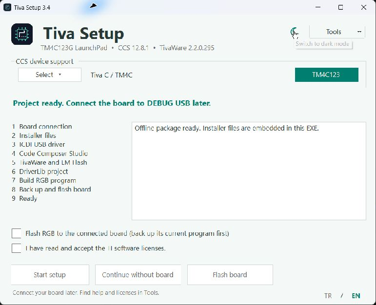

# Tiva Setup




Portable Windows setup for Tiva C / TM4C development. Prepare CCS, drivers, TivaWare and a working DriverLib RGB project from one executable.

Use the **moon / sun** button at the top right to switch light and dark themes. The theme is remembered and also applies to help and license windows. The original chip logo is used for the EXE, window and header. Text panels use themed scroll thumbs only when their content overflows; license tabs and borders follow the active theme. Text remains selectable and keyboard navigation is preserved.

Click **TR / EN** at the bottom right. The choice is saved. Controls, application progress, help and license explanations change language. Vendor licenses and external installer diagnostics retain their original wording.

## Use

- **TivaSetup-3.4.exe**: full offline package, about 1.55 GB, with four original TI archives. Works from a PC or USB drive; embedded files need no TI account.
- **TivaSetupLite-3.4.exe**: small launcher; checks local files, cache and USB, then offers official downloads. Users complete TivaWare sign-in and personal declarations in their own browser.

Click **Select** under CCS device support. Tick any of the 20 CCS 12.8.1 families, or use **Select all**, then **Done**. Every family can be unticked, including TM4C. The **TM4C123** button on the right selects only TM4C. With no selection, setup is disabled. The list follows light/dark mode; disabled choices stay readable during setup. Read **Tools > Licenses**, accept the checkbox and select **Start setup** or **Continue without board**. Administrator permission is requested when setup starts. Right-click **Run as administrator** also works.

Later, connect one EK-TM4C123GXL to **DEBUG USB**, with **POWER SELECT = DEBUG**, then select **Flash board**. The prepared project is remembered. Before every flash, processor identity is checked and the existing 256 KB program is backed up; failure stops flashing.

**Scope:** automatic RGB project creation and flashing target **TM4C123GH6PM / EK-TM4C123GXL**. Family selection configures a new CCS installation. Existing CCS is kept; additional families are not automatically installed. Without TM4C selected, ICDI/TivaWare/LM Flash and RGB steps are skipped. This tool does not generate firmware for other boards.

## Components

| Component | Purpose | Official download |
|---|---|---|
| CCS 12.8.1 | Editor, debugger; includes ARM 20.2.7.LTS compiler | [CCS](https://www.ti.com/tool/download/CCSTUDIO/12.8.1) |
| ICDI 2.0.12245 | DEBUG USB driver | [LaunchPad software](https://www.ti.com/tool/SW-EK-TM4C123GXL) |
| TivaWare 2.2.0.295 | DriverLib and examples | [TivaWare](https://www.ti.com/tool/download/SW-TM4C/2.2.0.295) |
| LM Flash 1.0.1588 | Alternative programmer | [LaunchPad software](https://www.ti.com/tool/SW-EK-TM4C123GXL) |

Windows 10/11 x64 and built-in .NET Framework are required. Users do not need Python or Node.

## Paths and behavior

New CCS: `C:/ti/ccs1281/ccs` (a detected existing 12.8.1 location is reused). TivaWare: `C:/ti/TivaWare_C_Series-2.2.0.295`. Workspace: `C:/ti/workspace_tm4c_ccs1281`. Desktop shortcut: **Tiva Setup - CCS**.

Default CCS support is `PF_TM4C`; for a new installation, selected families are passed as a comma-separated list to the TI installer. All families omits that restriction. Existing CCS 12.8.1 is located under C:/ti or from its Windows uninstall registration and detected from its application executables and is always skipped, regardless of family selection or a missing family marker. Missing TM4C/compiler support is reported without automatic reinstallation; add it explicitly with your existing CCS installer. Edited projects and previous CCS versions are preserved. Language preference is stored under `%LOCALAPPDATA%/TivaSetup/`; `theme.txt` remembers the selected theme. Previous state, cache, logs and backups stay compatible under `%LOCALAPPDATA%/TM4C-Ders-Kurulum/`; internal paths retain their names to preserve existing data.

Installer files are SHA-256 checked. Public downloads start together. TivaWare is staged and verified before moving into place. TI projectCreate/projectBuild prepares DriverLib with ARM 20.2.7.LTS; DSS backs up flash, loads the program and verifies the RGB counter.

CCS setup may take many minutes; a waiting message appears each minute. **Stop** takes effect after the current installer finishes. Close CCS if it is using the application's workspace. **Tools** contains Open CCS, Logs and backups, Licenses and Quick guide.

## Build

Source layout: `otomatik-kurulum/` contains C# sources, manifest, translations, help and build.py; `kurulum-kaydi/ilk_program_main.c` contains the example. Place the four original TI archives named in build.py under `indirilenler/`.

Use Windows, Python 3.11+ and the built-in .NET Framework C# compiler. The build checks archive hashes and reads SDK hashes/licenses from the verified TivaWare installer, so an installed SDK is unnecessary. The CCS 12.8.1 license manifest must be available at `otomatik-kurulum/build/ccs12-manifest.html` or in an installed CCS at the path above. Logo assets (SVG, PNG and multi-size ICO) are included; `make_icon.py` needs Pillow only when regenerating the icon.

```text
python otomatik-kurulum/build.py
python otomatik-kurulum/build.py --launcher-only
```

Output: `output/windows/`. The full EXE appends a streaming ZIP payload and footer to the launcher. No account credentials, user files or installation logs are included.

## Validation

```text
TivaSetup-3.4.exe --verify
TivaSetupLite-3.4.exe --self-test
TivaSetupLite-3.4.exe --localization-test
TivaSetupLite-3.4.exe --setup-plan-test
TivaSetupLite-3.4.exe --existing-ccs-test
TivaSetupLite-3.4.exe --prepare-test --all-devices
```

These check embedded archives, archive paths/Windows arguments/CCS selection, localization with file path preservation, and project building without flashing. Prepare-test requires installed components. UI-only options `--ui-preview` and `--ui-busy-preview` disable setup actions; the latter also disables choices to reproduce installation appearance. Development options `--flash-test` / `--flash-prepared-test` write to hardware; `--install-no-board-test` performs actual software installation.

CCS 12.8.1 TM4C-only installation without a board, DriverLib building and subsequent real-board programming were tested on the development PC. Other components were already present during that installation. All-family installation and a fully clean Windows environment have not been fully tested. Version 3.4 removes automatic CCS family expansion and mandatory TM4C selection. On the development PC, default/custom/all selections schedule no installer for existing components. A C2000-only run completes without spawning installers. The TM4C all-selection regression builds the project without reinstalling software or flashing. The native family menu and TM4C-only shortcut were checked in light/dark mode. Fresh installation with a custom non-TM4C selection remains untested.

## Vendor terms

Independent tool; not an official Texas Instruments product. The original installer archives and license texts are preserved. Bilingual explanations do not replace vendor terms. Consult the embedded CCS manifest, TivaWare EULA/TI BSD license and original ICDI/LM Flash license files. The application is unsigned.

## References

- [TI installer command line](https://software-dl.ti.com/ccs/esd/documents/ccs_installer-cli.html)
- [TI automated builds and scripting](https://software-dl.ti.com/ccs/esd/documents/ccs_automated-testing.html)

## Sharing on GitHub

Extract the source ZIP and put its contents in the repository. Upload **TivaSetup-3.4.exe** as a **Release asset**, rather than committing it to Git. GitHub blocks regular Git files over 100 MiB; release assets can be up to 2 GiB. This offline EXE is below that release limit.

[GitHub file limits](https://docs.github.com/en/repositories/working-with-files/managing-large-files/about-large-files-on-github) · [GitHub releases](https://docs.github.com/en/repositories/releasing-projects-on-github/about-releases)

Windows 11 title-bar colors use [documented DWM attributes](https://learn.microsoft.com/en-us/windows/win32/api/dwmapi/ne-dwmapi-dwmwindowattribute). Older Windows versions retain their native frame if an attribute is unsupported.

Text scrolling uses documented edit-control messages: [EM_LINESCROLL](https://learn.microsoft.com/en-us/windows/win32/controls/em-linescroll), [EM_GETFIRSTVISIBLELINE](https://learn.microsoft.com/en-us/windows/win32/controls/em-getfirstvisibleline), [EM_GETLINECOUNT](https://learn.microsoft.com/en-us/windows/win32/controls/em-getlinecount).
