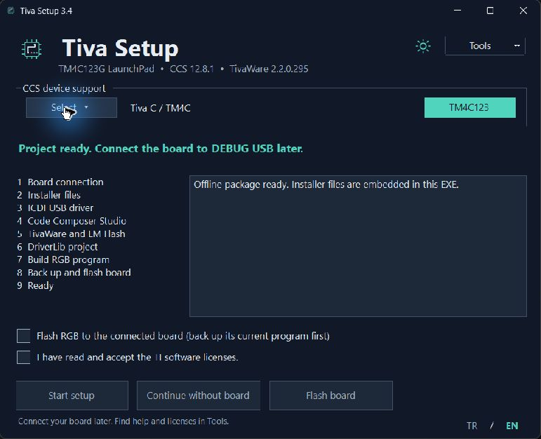

# TM4C123G

Texas Instruments **Tiva C TM4C123G LaunchPad (EK-TM4C123GXL)** ile çalışmak için geliştirdiğimiz araçların, örneklerin ve ileride ekleyeceğimiz kütüphanelerin ortak deposu.

## İçerik

| Klasör | İçerik | Sürüm |
| --- | --- | --- |
| [01TivaSetup](01TivaSetup/README.md) | Windows için geliştirme ortamı hazırlama ve örnek RGB LED projesi yükleme aracı | 3.4 |

Yeni kütüphaneler ve araçlar kendi klasörlerinde, ayrı README ve kullanım örnekleriyle eklenecek. İlk aktarım Tiva Setup’ın dağıtımını, kullanım belgelerini ve [kaynak kodunu](01TivaSetup/source/README.md) içerir.

## Tiva Setup

[Kurulum ve kullanım](01TivaSetup/README.md) · [Tiva Setup 3.4 indir](https://github.com/furkanyrtsvr/TM4C123G/releases/tag/tivasetup-v3.4.0)
